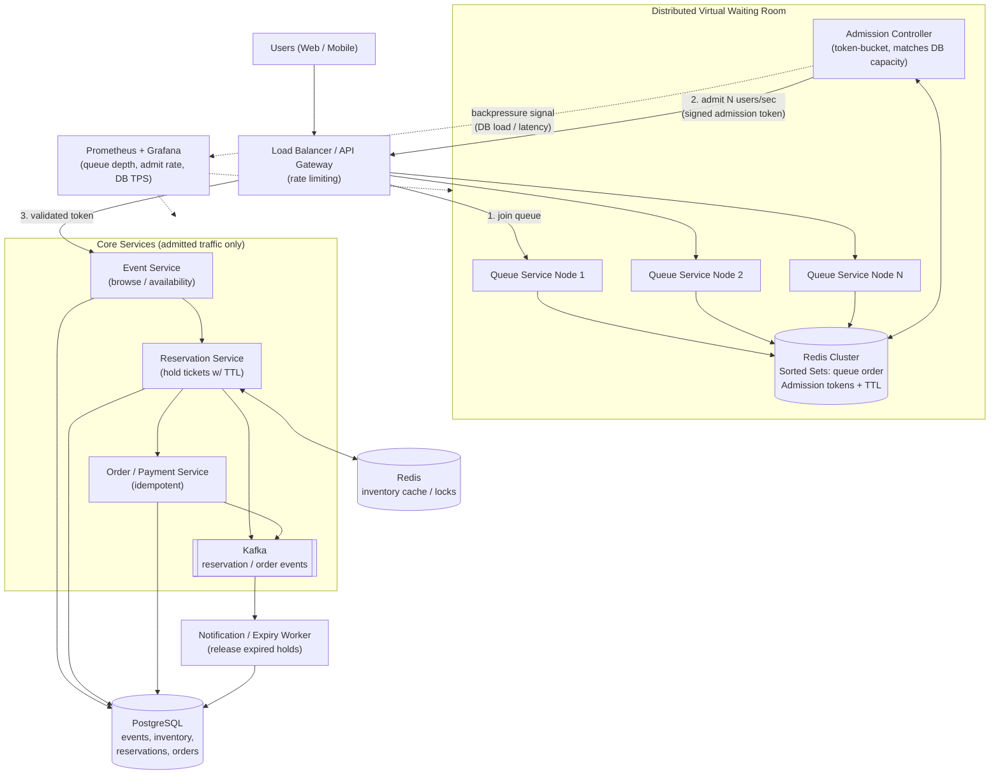

# High-Concurrency Ticketing / Flash Sale System

## Title

**High-Concurrency Ticketing / Flash Sale System with a Distributed Virtual Waiting Room**

*CMPE 273 – Enterprise Distributed Systems (FA26), Section 01, San José State University*

---

## Abstract

This project is a distributed ticketing platform for high-demand events such as concerts or sports games, where many users compete for a limited number of tickets at the same moment. Users can browse events, check ticket availability, reserve tickets, and complete purchases. The system guarantees that tickets are never oversold while staying responsive during sudden traffic spikes.

**Project challenge: fair-queue ingress processing.** A flash sale can send millions of requests toward the API gateway at once. If every request reaches the application and database together, the resulting "thundering herd" can overwhelm the system before it can decide which users to serve. To prevent this, we build a **distributed virtual waiting room** that:

- places users in a fair **first-in, first-out (FIFO)** queue,
- issues **queue tokens** across distributed nodes,
- **admits users at a controlled rate** matched to the backend database's transaction capacity, and
- keeps queue order and admission correct even when individual nodes fail.

The waiting room coordinates queue positions and admission across nodes using **Redis Sorted Sets** (and/or **Kafka partitions**). The design preserves queue order, avoids admitting more traffic than downstream services can handle, and continues operating reliably throughout a high-demand sale.

**Key distributed-systems concepts covered**

- Distributed virtual waiting rooms
- FIFO queueing and fair admission
- Redis Sorted Sets / Kafka partitions
- Rate limiting and backpressure
- Load balancing and concurrent request handling
- Distributed coordination
- Fault tolerance and idempotent operations
- Consistency between ticket availability, reservations, and purchases

---

## Business Value

- **No overselling.** Strongly consistent inventory ensures each ticket is sold at most once, protecting revenue, brand trust, and avoiding refunds and customer-support costs.
- **Fairness for customers.** A FIFO waiting room replaces "whoever refreshes fastest wins" with a transparent, first-come-first-served experience, reducing frustration and bot advantage.
- **Resilience during spikes.** Controlled admission and backpressure protect the database and core services, so the platform stays up at peak demand instead of crashing under a thundering herd.
- **Predictable cost and capacity.** Admission is tied to measured backend throughput, so the system does not need to be massively over-provisioned for a few minutes of peak traffic.
- **Reliable purchases.** Idempotent operations and expiring reservations prevent double charges, lost orders, and tickets stuck in limbo when users abandon checkout or services fail.
- **Reusable pattern.** The same waiting-room approach applies to any flash-sale scenario: product drops, registrations, limited-seat bookings, and more.

---

## A Proposed Architecture Diagram

**Request flow**

1. A user hits the sale page and is routed through the load balancer to any waiting-room node, which assigns a queue position (Redis Sorted Set scored by arrival timestamp/sequence) and returns a queue token.
2. The client polls (or receives a push) for its position. The admission controller releases users from the head of the queue at a rate matched to backend capacity and issues a short-lived, signed admission token.
3. Only users with a valid admission token reach the core services, where they check availability and reserve tickets.
4. A reservation atomically decrements inventory and holds the tickets for a limited time (TTL). The user then completes payment.
5. Orders are processed idempotently (idempotency keys). Expired or abandoned reservations are released back to inventory by a background worker.
6. Metrics such as queue depth, admit rate, and DB transactions per second feed back into the admission rate (backpressure).

---

## Proposed Technology Used

| Layer | Technology |
|---|---|
| Frontend | React (waiting-room page, event browsing, checkout) |
| Load balancer / API gateway | NGINX or Envoy (rate limiting, routing, token validation) |
| Backend services | Java / Spring Boot microservices (or Node.js / Express) |
| Waiting room queue & coordination | Redis Cluster – Sorted Sets (FIFO order), Lua scripts for atomic ops; Kafka partitions as an alternative/complement for ordered ingestion |
| Messaging / events | Apache Kafka (reservation and order events, expiry handling) |
| Database | PostgreSQL (transactional inventory, reservations, orders) |
| Caching / distributed locks | Redis (inventory cache, reservation holds with TTL) |
| Containerization & orchestration | Docker, Docker Compose / Kubernetes |
| Observability | Prometheus, Grafana |
| Load & concurrency testing | k6 or Locust (simulated flash-sale traffic, oversell checks) |
| Source control / CI | GitHub, GitHub Actions |

---

*Each team lead submits only one.*
