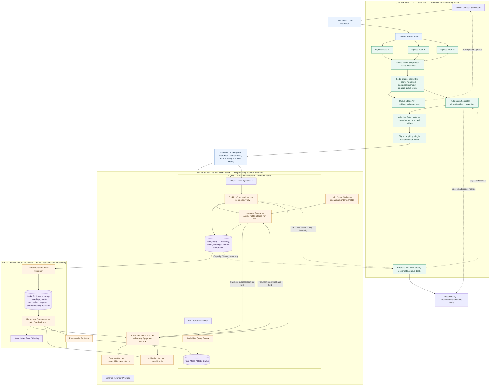

# High-Concurrency Ticketing / Flash Sale System

## Title

**High-Concurrency Ticketing / Flash Sale System with a Distributed Virtual Waiting Room**

*CMPE 273 – Enterprise Distributed Systems (FA26), Section 01, San José State University*

---

## Abstract

This project is a distributed ticketing platform for high-demand events such as concerts or sports games, where many users compete for a limited number of tickets at the same moment. Users can browse events, check ticket availability, reserve tickets, and complete purchases. The system guarantees that tickets are never oversold while staying responsive during sudden traffic spikes.

**Project challenge: fair-queue ingress processing.** A flash sale can send millions of requests toward the API gateway at once. If every request reaches the application and database together, the resulting "thundering herd" can overwhelm the system before it can decide which users to serve. To prevent this, we build a **distributed virtual waiting room** that:

- places users in a fair **first-in, first-out (FIFO)** queue using an atomic global sequence number,
- issues opaque **queue tokens** across distributed ingress nodes,
- **admits users oldest-first at a controlled rate** matched to the backend database's transaction capacity (adaptive, with bounded in-flight requests), and
- keeps queue order and admission correct even when individual nodes fail.

The waiting room coordinates queue positions and admission across nodes using **Redis Sorted Sets** (and/or **Kafka partitions**). The design preserves queue order, avoids admitting more traffic than downstream services can handle, and continues operating reliably throughout a high-demand sale.

Behind the waiting room, the booking path uses **microservices**, **CQRS** (separate read and write paths), an **atomic inventory service**, and **event-driven processing** (transactional outbox + Kafka + idempotent consumers) so that ticket availability, reservations, and purchases stay consistent even when services fail or retry.

**Key distributed-systems concepts covered**

- Distributed virtual waiting rooms
- FIFO queueing and fair admission
- Redis Sorted Sets / Kafka partitions
- Rate limiting, adaptive admission, and backpressure
- Load balancing and concurrent request handling
- Distributed coordination (atomic global sequencer)
- Fault tolerance and idempotent operations
- Consistency between ticket availability, reservations, and purchases
- CQRS, event-driven architecture, transactional outbox, and the saga pattern

---

## Business Value

- **No overselling.** Atomic inventory holds plus database unique constraints ensure each ticket is sold at most once, protecting revenue and brand trust and avoiding refunds and customer-support costs.
- **Fairness for customers.** A FIFO waiting room replaces "whoever refreshes fastest wins" with a transparent, first-come-first-served experience (with live position and estimated wait), reducing frustration and bot advantage.
- **Resilience during spikes.** Controlled admission and backpressure protect the database and core services, so the platform stays up at peak demand instead of crashing under a thundering herd. CDN/WAF protection absorbs abusive traffic at the edge.
- **Predictable cost and capacity.** Admission is tied to measured backend throughput, so the system does not need to be massively over-provisioned for a few minutes of peak traffic.
- **Reliable purchases.** Single-use admission tokens, idempotent payments and consumers, expiring holds, and saga-based compensation prevent double charges, lost orders, and tickets stuck in limbo when users abandon checkout or services fail.
- **Independent scaling.** Read-heavy availability checks scale separately from write-heavy bookings, so browsing traffic never starves purchases.
- **Reusable pattern.** The same waiting-room approach applies to any flash-sale scenario: product drops, registrations, limited-seat bookings, and more.

---

## A Proposed Architecture Diagram

**Legend:** blue = edge / gateway, green = waiting room, orange = services, purple = data stores. Dotted arrows are telemetry or asynchronous feedback.

**Request flow**

1. **Edge:** Traffic passes through CDN / WAF / DDoS protection and a global load balancer, which spreads requests across the waiting-room ingress nodes.
2. **Join the queue:** An ingress node takes the next number from the atomic global sequencer (Redis `INCR` / Lua) and inserts an opaque queue token into a Redis Sorted Set, scored by that sequence. This gives a strict FIFO order across all nodes.
3. **Wait:** The client polls (or receives SSE updates from) the Queue Status API for its position and estimated wait.
4. **Admission:** The admission controller picks the oldest waiting users in batches. An adaptive token-bucket rate limiter with bounded in-flight requests sets the pace, using backend TPS, DB latency, error rate, and queue depth as feedback (backpressure). Admitted users receive a signed, expiring, single-use admission token.
5. **Gateway:** The protected booking gateway verifies the token's signature, expiry, replay status, and user binding before any request reaches the booking services.
6. **Browse (query path):** Availability checks are served by the query service from a Redis-backed read model, keeping reads off the transactional database.
7. **Reserve (command path):** The booking command service (with an idempotency key) asks the inventory service to atomically place a time-limited hold. Database unique constraints guarantee no ticket is held or sold twice.
8. **Pay:** The saga orchestrator drives payment through the payment service (idempotent calls to the external provider). On success the hold is confirmed; on failure or timeout the hold is released. The expiry worker also releases abandoned holds.
9. **Events:** State changes are written with a transactional outbox and published to Kafka. Idempotent consumers (with retries, deduplication, and a dead-letter topic) trigger notifications, advance the saga, and update the read model.
10. **Observe:** Prometheus and Grafana track queue depth, admission rate, DB TPS, and error rates, and also feed the admission controller.

---

## Proposed Technology Used

| Layer | Technology |
|---|---|
| Frontend | React (waiting-room page with live position, event browsing, checkout) |
| Edge / security | CDN + WAF (e.g., Cloudflare or AWS CloudFront/WAF) for DDoS and bot protection |
| Load balancer / API gateway | NGINX or Envoy (routing, rate limiting, admission-token verification) |
| Backend services | Java / Spring Boot microservices (or Node.js / Express): ingress, queue status, admission, availability query, booking command, inventory, payment, notification |
| Waiting room queue & coordination | Redis Cluster – `INCR` + Lua scripts (atomic global sequencer), Sorted Sets (FIFO order); Kafka partitions as an alternative/complement for ordered ingestion |
| Admission tokens | Signed, expiring, single-use tokens (JWT / HMAC) with replay protection in Redis |
| Messaging / events | Apache Kafka (topics, consumer groups, dead-letter topic) with the transactional outbox pattern |
| Database | PostgreSQL (transactional inventory, holds, bookings; unique constraints) |
| Caching / read model | Redis (availability read model, reservation hold TTLs) |
| Patterns | CQRS, saga orchestration, idempotency keys, transactional outbox |
| Payments | Mock / sandbox payment provider (e.g., Stripe test mode) |
| Containerization & orchestration | Docker, Docker Compose / Kubernetes |
| Observability | Prometheus, Grafana (metrics, dashboards, alerts) |
| Load & concurrency testing | k6 or Locust (simulated flash-sale traffic, oversell and ordering checks) |
| Source control / CI | GitHub, GitHub Actions |

---

*Each team lead submits only one.*
